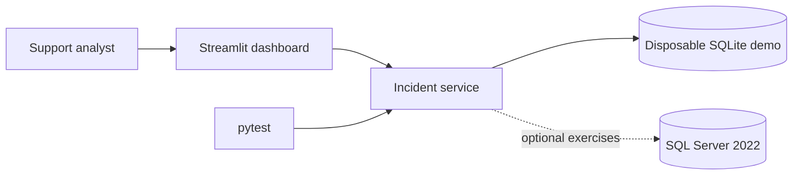

# Architecture

The incident catalogue is immutable metadata; reproductions mutate only a disposable database. Database reset is intentionally cheap. SQLite makes the portfolio immediately inspectable, while SQL Server assets demonstrate platform-specific investigation without claiming local verification.

