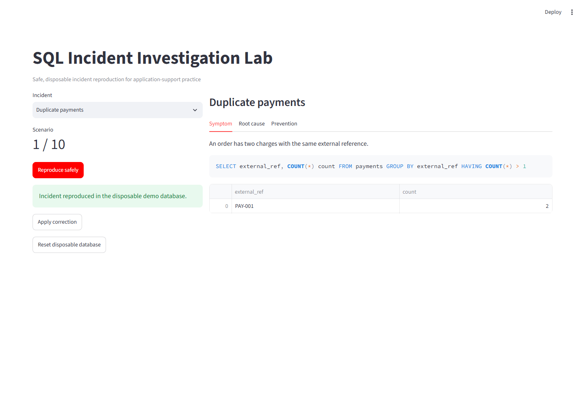

# SQL Incident Investigation Lab



[Mobile workflow screenshot](docs/screenshots/mobile.png)

A safe support-engineering practice environment containing ten reproducible wholesale-distribution data incidents. The default Streamlit application uses a disposable SQLite database so it runs without infrastructure; SQL Server-specific deadlock material and an opt-in Compose profile are included for platform practice.

**Status:** portfolio lab, locally verified on 14 November 2026. See [VERIFICATION.md](VERIFICATION.md) for commands, results and database boundaries.

## Quick start

```powershell
py -m venv .venv
.venv\Scripts\Activate.ps1
pip install -e ".[dev]"
pytest -q
streamlit run app.py
```

Reset the database from the UI after each exercise. Never point incident reproduction at production data.

### Verified SQL Server path

On Windows with SQL Server Express and Windows authentication:

```powershell
sqlcmd -S ".\SQLEXPRESS" -E -C -b -i sqlserver/setup.sql
sqlcmd -S ".\SQLEXPRESS" -E -C -b -i sqlserver/verify.sql
```

The verification runs duplicate-payment and incorrect-total reproduction/correction inside a transaction, rolls it back, and asserts the seed state is intact.

## What this demonstrates

- Triage from symptom to an evidence-producing query
- Transaction and data-integrity reasoning
- Safe reproduction, correction, prevention, and regression tests
- Duplicate, quality, indexing, import, total, audit, and concurrency failure modes

## Recruiter evidence

- Genuine desktop and mobile screenshots of the incident workflow.
- Five automated tests and Ruff checks passed locally on 14 November 2026.
- SQL Server scripts demonstrate transactional reproduction, correction, rollback and seed-state verification.
- Ten incident scenarios, architecture notes, an interview guide and a two-minute demonstration script are included.

## Limitations

SQLite and SQL Server 2022 Express paths are verified. The SQL Server scripts reproduced, corrected and rolled back duplicate-payment and incorrect-total incidents. Docker and the two-session deadlock capture remain `NOT VERIFIED`. The Docker SQL Server profile requires a user-supplied strong `MSSQL_SA_PASSWORD`.

The 2 November 2026 dependency audit reports Pillow 12.3 advisories whose published fix is Pillow 13. Streamlit 1.65 currently constrains Pillow to `<13`, so this transitive finding is unresolved; the application does not accept or process image uploads, reducing exposure but not removing the dependency risk.

See [ARCHITECTURE.md](ARCHITECTURE.md), [INTERVIEW_GUIDE.md](INTERVIEW_GUIDE.md), [TWO_MINUTE_DEMO.md](TWO_MINUTE_DEMO.md), and `docs/incidents.md`.

